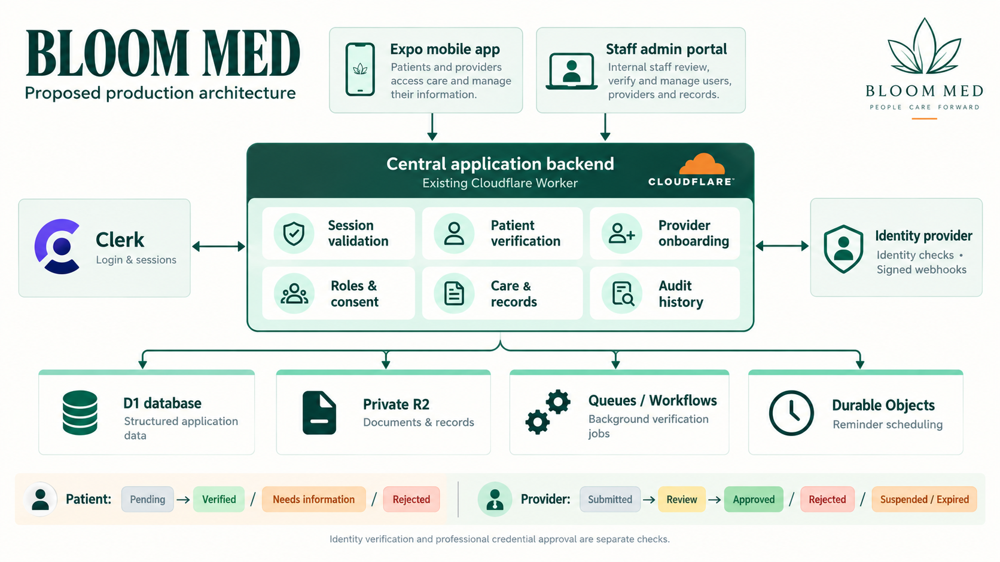

# BLOOM MED mobile app

Expo React Native app for Android and iOS with local demo and cloud modes. Uses Expo SDK 58, Expo Router native stacks and tabs, TypeScript and shared clinic state.

Cloud mode adds Clerk Google-only OAuth, authenticated Worker endpoints, D1 care data, private R2 attachments, server-assigned care-team access and conflict-safe syncing. See [cloud setup](backend/SETUP.md). The cloud code has local integration tests; live connection awaits your Clerk and Cloudflare configuration. Demo mode remains the default until configured.

## Proposed production architecture

Doctor dashboard and connected patient/doctor call mockups are available in [UI design concepts](docs/design/README.md). These are visual references and have not yet been applied as the implemented app UI.

Self-hosted appointment audio/video integration and its three-call pilot cap are documented in [Self-hosted consultations](docs/self-hosted-consultations.md).

The first manual-verification release is documented in [Manual verification — India](docs/manual-verification-release.md), including the applicant flow, reviewer permissions and rollout limits.

The proposed architecture expands the existing Cloudflare Worker into the central backend for patient verification, provider onboarding, roles, consent and care data. The diagram includes planned components and does not represent every feature as implemented.



[Open the full-size architecture diagram](docs/architecture/bloom-med-production-architecture.png)

## Open on your phone

```powershell
cd "E:\Bloom Med\bloom-med"
npm install
npm start -- --lan
```

Open a compatible Expo Go app and scan the terminal QR code on the same Wi-Fi. The active development session uses exp://192.168.0.5:8083. The address can change when your network changes. Demo OTP: **123456**. Login accepts any valid email/mobile number. No SMS is sent.

## What is functional

- Persistent demo session, profile onboarding, edit profile, sign-out and role switching.
- Doctor and nurse search with approved-provider availability and detailed profiles.
- Three-step booking with live date selection, unavailable slots, service, duration/frequency, address and visit reason.
- Appointment detail, chronological care calendar, rescheduling and confirmed cancellation.
- Nurse bookings become requests in the selected nurse's queue. Accept, start, complete checklist, record notes and complete the same visit.
- Each professional sees their own visits. Switch provider identity in Profile to work with a different doctor or nurse.
- Doctors start consultations, save notes, prescribed medicine reminders and follow-up recommendations before completing visits.
- Care plans appear in patient records; prescribed reminders appear in Medicines; follow-up links open a new booking with the recommended date.
- Native attachment storage in the app document directory, image preview, PDF/image opening via the system share sheet, and removal of the app's local copy. Original source files stay unchanged.
- Medicine reminders, taken/skipped/undo actions, daily logs, seven-day adherence history and archival.
- Activity inbox with unread indicators and links to affected visits.
- Patient-controlled family consent with immediate UI and action gates.
- Admin approvals control new booking availability; admin support requests can be resolved.
- In-app assistant with mock typing response and actionable navigation. Voice examples simulate input.
- Confirmed SOS simulation with a status timeline and end action. No real calls or services.
- Animated native screen transitions, fade/slide entrances, spring press feedback, haptics and reduced-motion support.

## End-to-end walkthrough

1. Patient: log in, complete onboarding, then Home nursing → select Sarah Thomas → book a future slot.
2. Profile → Nurse. Open Visits, accept the new request, start the visit, finish every task, add a summary and complete the visit.
3. Switch to Patient. Care shows the completed visit with the same nurse summary.
4. Book Dr. Aisha Khan, then switch to Doctor with Aisha selected. Start that visit.
5. Save consultation notes, a prescribed medicine reminder and a follow-up date, then complete the consultation.
6. Switch to Patient. Records contains the care plan; Medicines contains the new reminder. Open the completed visit and book the recommended follow-up.
7. Enable family access in Patient Profile. Switch to Family to review the same care. Revoke consent as Patient to lock Family again.
8. Add a fictional PDF/image in Records on a native phone. Open it or use the system share sheet.
9. Track medicine doses, check the activity inbox, submit a local support request and resolve it as Admin.

## Architecture

Routes: src/app/. UI and animation primitives: src/components.tsx. Screens: src/screens/. Pure care transitions and authorization checks: src/clinic.ts. Serialized local writes and migration: src/store.tsx. Provider/brand fixtures: src/data.ts.

The v2 store migrates data from the previous prototype without modifying its original storage key. Writes are queued to preserve the latest state during rapid edits. The pure transition layer rejects invalid status changes, booking conflicts and actions from the wrong role.

## Validation

```powershell
npm run lint
npm run typecheck
npm test
npx expo export --platform all --output-dir build-refined
```

Domain tests exercise complete doctor/nurse journeys, consent, provider scoping, duplicate slots, rescheduling, prescriptions, daily logs, records, support, approvals, SOS and JSON migration. Bundle export validates compilation, not a signed APK/IPA. Native device testing remains needed for file picking/sharing, haptics, keyboard and navigation.

## Local demo limits

Demo mode uses fictional data and unencrypted device storage. Its role selection is only for the walkthrough. Cloud mode uses Clerk sessions, server-assigned roles and private care spaces; care data is not written to the demo storage key. The provider directory, clinical assistant, voice and SOS remain simulations in both modes. No background push notifications, payments or real emergency dispatch are integrated. Recurring care is a request carrying its frequency; it does not generate a recurring calendar series. See backend/SETUP.md for the cloud rollout limits.

The browser is an optional development preview. Native phone attachment copies are persistent; browser attachment records contain metadata only. The assistant and voice input remain mock interactions.

Dependency audit currently reports 26 findings (14 high, 12 moderate) in the dependency tree. SDK-breaking forced downgrades were not applied. ESLint 9 is pinned for compatibility with Expo's lint plugins.

SDK 58 uses React Native 0.88 and React 19.3. After upgrading from SDK 57, rebuild the development APK; an SDK 57 development app cannot load SDK 58 native modules. Email-code sign-in can be tested with the configured Clerk instance; Google SSO still requires the installed development/release app and native callback configuration.

## Medicine notifications

Cloud schedule sync and server push are implemented in the existing Cloudflare backend. Each phone chooses local offline alerts or cloud push in Medicines; the app does not send both. See [backend activation and Firebase/EAS setup](backend/SETUP.md#cloud-medicine-reminders--existing-worker). The migration/deployment and live device checks are separate from local tests.

In the patient Medicines screen, enable medicine notifications and allow the phone permission. Each active medicine can have 1–6 daily alert times (24-hour clock). Use the test button to schedule an alert five seconds later. Names are hidden by default and can be enabled explicitly.

Reminders are stored per account on this device and scheduled locally, including while the app is closed. Turning reminders off, archiving a medicine or signing out cancels the associated alerts. Alerts repeat daily until disabled or archived; they do not interpret free-text prescription duration or stop automatically when a dose is marked taken. Changes from another device take effect after this phone syncs. Phone timezone, battery restrictions and notification settings can affect delivery. A new APK build is required to include the notifications plugin; local notifications can also be tested with compatible Expo Go. Physical-device delivery must be verified using the test button.
