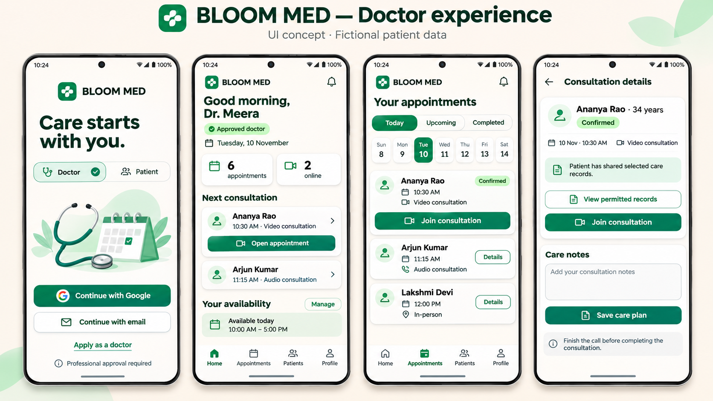
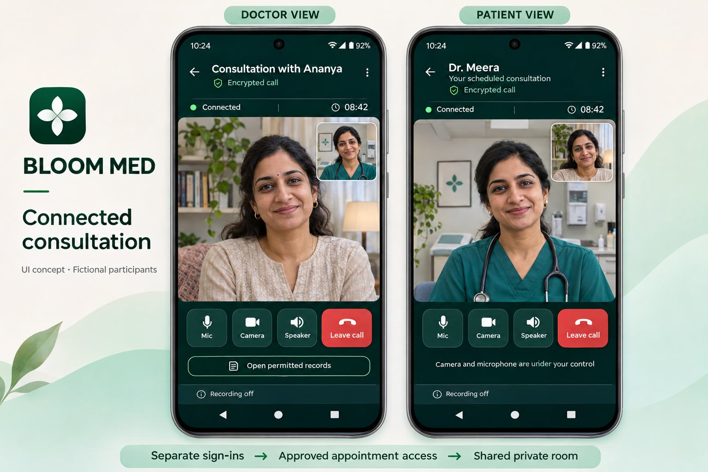

# Patient and doctor UI concepts

Generated design references, not screenshots of implemented screens or a real consultation. All patient/doctor identities and appointments shown are fictional. Generated with the built-in image generation tool.

## Doctor experience

Separate doctor and patient entry choices use the existing Google/email authentication. Choosing Doctor does not grant professional permissions. The backend must verify approval and assignments before showing the doctor's workspace or granting clinical access.

## Connected consultation

The patient and approved assigned doctor sign in independently and join the same appointment-specific room. The doctor's interface includes permitted-record access; the patient has clear media controls. Encryption/connection labels must reflect the real SDK state when implemented. These concept images do not prove a successful two-device test.

## Generation prompts

### Doctor experience

Use case: ui-mockup. Create a premium high-fidelity mobile UI design presentation for the actual brand BLOOM MED, a React Native healthcare app in India. Landscape 16:9 image, four full upright Android phone screens side by side, perfectly readable large typography, coherent design system. Background warm ivory with restrained mint accents, emerald #147D68 primary buttons, deep forest headings, rounded white cards, subtle shadows, refined modern medical interface, compact white four-petal leaf/cross mark inside emerald rounded square like BLOOM MED branding. Top presentation heading 'BLOOM MED — Doctor experience' and small subtitle 'UI concept · Fictional patient data'. Four screens left to right: 1 Doctor sign-in, branded logo top, heading 'Care starts with you.', doctor role visibly selected, elegant illustration of stethoscope and calendar occupying modest area, main button 'Continue with Google', secondary 'Continue with email', text link 'Apply as a doctor', note 'Professional approval required'. Do not include password fields or self-verification controls. 2 Doctor dashboard, greeting 'Good morning, Dr. Meera', small green status 'Approved doctor', date 'Tuesday, 10 November', compact summary cards '6 appointments' and '2 online', heading 'Next consultation', patient 'Ananya Rao', '10:30 AM · Video consultation', clear button 'Open appointment', a second upcoming patient card, compact 'Your availability' with 'Manage' action, bottom nav Home / Appointments / Patients / Profile with Home active. 3 Appointments, heading 'Your appointments', segmented 'Today / Upcoming / Completed', compact weekly date strip with 10 selected, three crisp appointment cards showing fictional patients, times and modes; first 'Ananya Rao', '10:30 AM', 'Video consultation', small Confirmed pill, button 'Join consultation'; next 'Arjun Kumar', '11:15 AM', 'Audio consultation', details button; third 'Lakshmi Devi', '12:00 PM', 'In-person', details button. Bottom same doctor navigation Appointments active. 4 Appointment workspace, heading 'Consultation details', fictional patient 'Ananya Rao · 34 years', status Confirmed, date/time '10 Nov · 10:30 AM', 'Video consultation', clear short notice 'Patient has shared selected care records', actions 'View permitted records', 'Join consultation', and lower card 'Care notes' with placeholder 'Add your consultation notes', button 'Save care plan'; muted note 'Finish the call before completing the consultation'. Keep distinction between joining a call and completing a medical visit. No patient diagnosis displayed on lock screens. Use consistent spacing and accessible touch targets. No clutter, no invented production completion badges, no marketing paragraphs. Screens must be complete from status bar through bottom safe area, with no cropped controls. Presentation is a design concept only, no web dashboard or desktop browser chrome.

### Connected consultation

Use case: ui-mockup. Create a sophisticated high fidelity mobile UI concept board for BLOOM MED healthcare app: two large full-height Android phone screens side by side, one doctor's view and one patient's view of THE SAME private video consultation. Wide landscape image, two phones occupying most canvas, generous margins, premium warm ivory and mint presentation background, polished emerald healthcare brand with white four-petal cross mark in dark green rounded square. Header 'BLOOM MED — Connected consultation' subtitle 'UI concept · Fictional participants'. Doctor phone on LEFT with small label above 'DOCTOR VIEW'; patient phone RIGHT label above 'PATIENT VIEW'. Both are connected to the same appointment and show consistent elapsed time '08:42'. Actual call interface dark forest teal, minimal green highlights, restrained white text, excellent contrast. Doctor screen header 'Consultation with Ananya' and shield lock 'Encrypted call'; main remote video is a natural photoreal friendly fictional Indian woman patient around 34, wearing a modest light neutral top at home. Small self-preview upper right shows fictional Indian female doctor Dr. Meera wearing teal scrubs, in a tidy clinic. Patient screen header 'Dr. Meera' with small text 'Your scheduled consultation' and shield lock 'Encrypted call'; main remote video shows THE SAME Dr. Meera seen in doctor's self-preview. Its self-preview shows THE SAME Ananya patient from doctor's main remote video. The faces and clothing must match across the corresponding remote and local previews, no reversed roles. Compact connection indicator 'Connected' and timer '08:42'. Beneath videos, clearly spaced rounded controls with universally recognizable symbols and short labels 'Mic', 'Camera', 'Speaker', and a prominent red 'Leave call' button. Doctor view has unobtrusive secondary button below call controls 'Open permitted records'; patient view has secondary text 'Camera and microphone are under your control'. A subtle status footer 'Recording off' on both, no recording button. Phone screens complete including status bar and bottom safe area; controls must not overlap video faces. Add a small explanatory strip outside phones below them: 'Separate sign-ins → Approved appointment access → Shared private room'. Use correct readable English, familiar Android iconography and clean modern typography. This is live audio/video consultation, not voice AI or audio-note recording. No private medical diagnoses, prescriptions or real patient information. No browser chrome. Design preview, not a claim of a live call or production approval.

## Implemented doctor workspace

Doctor sessions now open a dedicated dashboard with current-space appointment counts and next consultation. Appointment filters include Today, Upcoming, Requested, Completed and All plus search. Patients lists only assigned Doctor care spaces; opening one loads its appointments and permitted records. Consultation details show patient identity and connect existing accept/start, native call join, care-plan and completion handlers.

Patient/Doctor sign-in choices are navigation preferences for the same Clerk Google/email flows. They do not grant roles. The initial matching backend-assigned space is selected when available, otherwise the backend default is used. Applications remain under Profile > Verification. No approval badge is inferred from role alone.

Doctor navigation includes Dashboard, Appointments, Patients and Profile; records remain reachable from dashboard and visit details. Shared entrance animation respects reduced motion. Counts are scoped to the selected patient space. Cross-patient aggregate scheduling and editable provider availability remain pending. Physical two-device call validation and a fresh APK build are separate steps.

Cloud UI real-data policy: static fictional clinicians and sample initials are hidden. Cloud startup/sign-out state is blank. Discovery stays empty until a verified server catalogue is connected. Existing real clinical data is retained. Assistant simulation and SOS simulation are available only in local demo mode.

## Doctor login care scene

Implemented asset: `assets/doctor-login-care-v1.png`, generated with the built-in image generation tool. The doctor login uses a distinct doctor/patient consultation scene with the same warm, rounded photographic treatment as patient login. The solo portrait and medical-symbol infographic proposals were rejected and are not used by the app. Images are illustrative branding, not real clinician directory profiles or patient records.

Final prompt: Use case photorealistic-natural. Create a warm premium healthcare lifestyle photograph for the DOCTOR login of the Indian BLOOM MED mobile app, matching a welcoming patient-login image of compassionate care. Wide landscape 16:9 crop. Candid scene showing a friendly Indian doctor in emerald teal scrubs with a stethoscope speaking attentively with a seated Indian adult patient in a light cream kurta, both in natural three-quarter profile facing each other, relaxed reassuring eye contact, gentle conversational gestures, natural anatomy. A bright comfortable consultation room with warm ivory tones, a large softly sunlit window, tasteful indoor greenery, modest wooden table at lower edge. Both people present at similar prominence, waist-up, centered with ample crop margin, faces fully visible. Not a solo doctor portrait, not staring at camera, not the prior nurse holding an elderly woman's hands on a sofa. Modern, believable, inviting natural photography with soft mint and emerald palette, no text, logos, fake credentials, watermarks, visible medical paperwork, screens, infographics or medical-symbol collage.

Doctor entry routing now persists audience intent without resetting it on the login component's remount. Google, email and SSO callbacks use one route policy. Doctor intent without a backend Doctor membership opens Doctor account setup, not patient onboarding. The setup page links to Doctor verification and assigned spaces. See [video call setup](../video-call-quickstart.md) for the current backend prerequisites and pilot limits.
