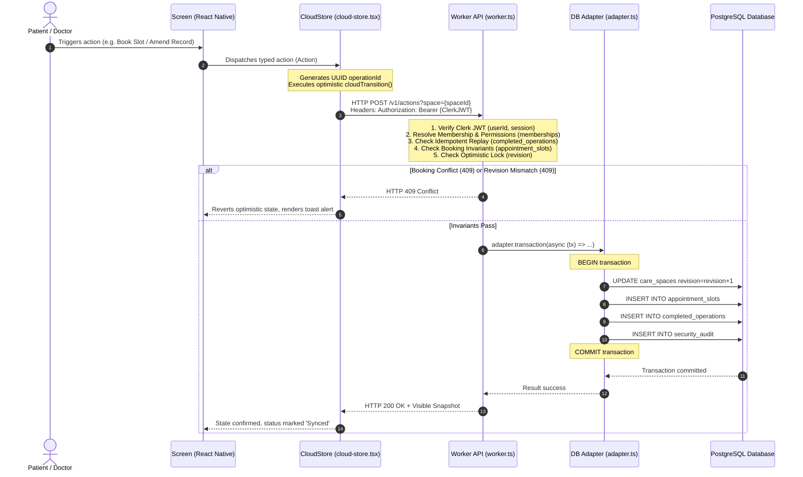

# BloomMed: PostgreSQL Migration Design & Database Adapter Specification

**Document Version:** 1.0.0  
**Owner:** Yakhoob Ahmed  
**Collaborator:** Darshan  
**Lead Approver:** ANC-DOMINATER  
**Target:** End of Week 2  
**Target Branch:** `feature/yakhoob/postgres-migration` (targeting `dev`)

---

## 1. Executive Summary & Objectives

BloomMed currently operates on Cloudflare D1 (edge SQLite) with Cloudflare R2 for file storage and Cloudflare Durable Objects for medicine reminder scheduling. As BloomMed scales its clinical care services, provider directory, and appointment booking concurrency, the backend requires:
1. True multi-statement ACID transactions with row-level locking (`SELECT ... FOR UPDATE`).
2. High-performance native `JSONB` querying and GIN indexing for clinical state, record history, and audit trails.
3. Strict data types (`TIMESTAMPTZ`, `BOOLEAN`, `BIGINT IDENTITY`, `UUID`).
4. Decoupling from proprietary Cloudflare D1 APIs via a vendor-agnostic Database Adapter Contract.

This document details the complete migration architecture, data mappings, adapter contract, parity test methodology, and production rollout/cutover strategy.

### Strict Scope Boundaries
- **IN SCOPE:** All 23 Cloudflare D1 tables (Care spaces, visits, medical records, memberships, verification, audit trails, appointment slots, and concurrency invariants).
- **EXPLICITLY OUT OF SCOPE (Acceptance Criteria):**
  - **Cloudflare R2 Object Storage (`env.FILES`):** File binaries (patient records, attachments, verification IDs) remain strictly in Cloudflare R2. Only document metadata is tracked in database tables.
  - **Medicine Reminder Durable Object SQLite (`env.REMINDERS`):** The internal SQLite database within `MedicineReminderScheduler` (`ctx.storage`) runs inside single-threaded Cloudflare Durable Objects and is explicitly excluded from this D1-to-PostgreSQL migration.
  - **Hosted Credentials:** Per dependencies, founder chooses PostgreSQL hosting provider and budget. Design, local schema, and adapter work are developed and verified locally with synthetic parity tests before hosted credentials exist.

---

## 2. Step 1: Screen-to-API-to-Database Flow



### Detailed Flow Walkthrough
1. **Screen Gesture:** User initiates a business action (e.g., booking an appointment in `src/screens/care.tsx`).
2. **Client Store Handling (`src/cloud-store.tsx`):**
   - Generates a UUID `operationId = randomUUID()`.
   - Runs `cloudTransition` to optimistically update local UI state.
   - Extracts active session JWT via `auth.getToken({ skipCache: true })`.
   - Issues `POST /v1/actions?space={spaceId}` via `src/cloud-api.ts`.
3. **Worker API Gateway (`backend/worker.ts`):**
   - Authenticates JWT claims (`userId`, `session`, `issuer`).
   - Validates care space membership and role (`Patient`, `Family`, `Doctor`, `Nurse`, `Admin`).
   - Checks `completed_operations` by exact `(space_id, operation_id)`. If present, short-circuits with `X-Idempotent-Replay: true`.
   - Checks slot availability in `appointment_slots` for active statuses (`Requested`, `Confirmed`, `In Progress`).
   - Verifies optimistic revision (`revision === snapshot.revision`).
4. **Database Execution via Adapter:**
   - Wraps all mutation queries inside an atomic transaction.
   - Increments revision, inserts appointment slot row, inserts operation ID, and logs immutable security audit entry.
5. **Response & Privacy Filtering:**
   - `visibleSnapshot` applies patient privacy gates (masks records/consultations if `recordsAccess` is ungranted).
   - Client reconciles response, increments revision counter, and confirms sync.

---

## 3. Step 2: D1 Table, Query & Stored JSON Inventory

The current D1 database consists of **23 tables** across the migrations through 0008:

### 3.1 Migration Inventory

| # | Table Name | Migration Source | Primary Key | Key Constraints & Indexes | Stored JSON Columns |
|---|---|---|---|---|---|
| 1 | `care_spaces` | `0001_care.sql` | `id TEXT` | PK (`id`) | `state TEXT` (Full `ClinicState` tree) |
| 2 | `memberships` | `0001_care.sql` | `(user_id, space_id)` | FK &rarr; `care_spaces(id)`, CHECK(`role` IN (...)) | None |
| 3 | `attachments` | `0001_care.sql` | `id TEXT` | FK &rarr; `care_spaces(id)`, Index `attachments_space` | None (Metadata only; blobs in R2) |
| 4 | `security_audit` | `0002_records.sql` | `id INTEGER AUTOINCREMENT` | Index `audit_space(space_id, id)` | None |
| 5 | `record_versions` | `0002_records.sql` | `(space_id, record_id, version)` | Composite PK | `metadata TEXT` (Serialized `RecordItem`) |
| 6 | `reminder_settings` | `0003_reminders.sql` | `(user_id, space_id)` | FK &rarr; `care_spaces(id)` | `preferences TEXT` (Serialized preferences) |
| 7 | `reminder_devices` | `0003_reminders.sql` | `id TEXT` | UNIQUE Index on `token WHERE token IS NOT NULL`, Index on `(user_id, space_id)` | None |
| 8 | `reminder_revoked_sessions` | `0003_reminders.sql` | `(user_id, session_id)` | Composite PK | None |
| 9 | `reminder_deliveries` | `0003_reminders.sql` | `id TEXT` | Index on `(user_id, space_id, status, next_attempt)` | None |
| 10 | `verification_reviewers` | `0004_manual_verification.sql` | `user_id TEXT` | PK (`user_id`), CHECK(`active` IN (0,1)) | None |
| 11 | `verification_applications` | `0004_manual_verification.sql` | `id TEXT` | UNIQUE(`user_id`, `kind`), Index on `(status, updated_at, id)` | `details TEXT` (Application form JSON) |
| 12 | `verification_documents` | `0004_manual_verification.sql` | `id TEXT` | Index on `(user_id, created_at)` | None |
| 13 | `verification_submission_documents` | `0004_manual_verification.sql` | `(application_id, submission_revision, document_id)` | FK &rarr; `applications(id)`, FK &rarr; `documents(id)` | None |
| 14 | `verification_events` | `0004_manual_verification.sql` | `id INTEGER AUTOINCREMENT` | UNIQUE(`application_id`, `revision`) | `details TEXT` (Review audit JSON) |
| 15 | `consultation_calls` | `0005_consultation_calls.sql` | `(space_id, visit_id)` | FK &rarr; `care_spaces(id)`, UNIQUE(`room_id`), Index on `(state, ends_at)` | None |
| 16 | `consultation_call_participants` | `0005_consultation_calls.sql` | `(room_id, user_id)` | Index on `(user_id, session_id)` | None |
| 17 | `consultation_call_slots` | `0005_consultation_calls.sql` | `slot INTEGER` | CHECK(`slot` BETWEEN 1 AND 3), UNIQUE(`room_id`) | None |
| 18 | `appointment_slots` | `0006_appointment_slots.sql` | `id TEXT` | UNIQUE Partial Index `appointment_active_slot` on `(provider_id, date, time) WHERE status IN ('Requested', 'Confirmed', 'In Progress')` | None |
| 19 | `completed_operations` | `0006_appointment_slots.sql` | `(space_id, operation_id)` | FK &rarr; `care_spaces(id)` | None |
| 20 | `organizations` | `0006_organizations.sql` | `id TEXT` | Directory seeds preserve organization IDs | None |
| 21 | `workspace_organizations` | `0006_organizations.sql`, `0007_workspace_requests.sql` | `space_id` | Care space and organization foreign keys; workspace display name | None |
| 22 | `organization_admins` | `0007_workspace_requests.sql` | `(user_id, organization_id)` | Organization foreign key; map `active` to BOOLEAN | None |
| 23 | `workspace_join_requests` | `0007_workspace_requests.sql`, `0008_workspace_join_attempt.sql` | `id TEXT` | Unique user and workspace; status check; review attempt; organization/status/update index | None |

### 3.2 Key Stored JSON Fields
1. `care_spaces.state`: Contains patient profile, clinical visits list, medicines, uploaded record descriptors, consultations, activities, approved items, and SOS state.
2. `record_versions.metadata`: Historical snapshot of medical records before amendment.
3. `reminder_settings.preferences`: Medication reminder schedule times and notification settings.
4. `verification_applications.details`: Professional council numbers, registration IDs, clinic addresses, and qualifications.
5. `verification_events.details`: Auditor actions, decision rationales, and suspension logs.

---

## 4. Step 3: SQLite/D1 to PostgreSQL Type & Query Mapping

### 4.1 Data Type Mapping Table

| SQLite / D1 Data Type | PostgreSQL Data Type | Rationale & Behavioral Difference |
|---|---|---|
| `INTEGER PRIMARY KEY AUTOINCREMENT` | `BIGINT GENERATED ALWAYS AS IDENTITY PRIMARY KEY` | Standard SQL identity generation; avoids sequence exhaustion and locks. |
| `TEXT` (ISO 8601 strings, e.g. `CURRENT_TIMESTAMP`) | `TIMESTAMPTZ` | Preserves microsecond timezone precision with UTC normalization. |
| `TEXT` (JSON serialized strings) | `JSONB` | Enables binary representation, fast access, and GIN index support for queries. |
| `INTEGER` (0 / 1 boolean flags) | `BOOLEAN` | Type-safe native booleans (`true` / `false`). Eliminates `0`/`1` integer ambiguity. |
| `TEXT` (UUID strings, e.g. `operationId`) | `UUID` or `VARCHAR(64)` | Supports standard UUID formatting with index compactness. |
| `INTEGER` (Unix epoch milliseconds) | `BIGINT` | Millisecond timestamps fit cleanly in 64-bit integer range. |

### 4.2 Query & Parameter Mapping

| SQLite / D1 Query Pattern | PostgreSQL Query Pattern |
|---|---|
| Parameter placeholders: `?` | Numbered placeholders: `$1, $2, ...` |
| JSON field extraction: `json_extract(state, '$.profile.name')` | Native JSON operator: `state->'profile'->>'name'` |
| JSON array iteration: `json_each(state, '$.visits')` | Native JSON function: `jsonb_array_elements(state->'visits')` |
| Partial Unique Index: `CREATE UNIQUE INDEX ... WHERE status IN (...)` | Identical syntax: `CREATE UNIQUE INDEX ... WHERE status IN ('Requested', 'Confirmed', 'In Progress');` |
| Batch array: `env.DB.batch([stmt1, stmt2])` | Multi-statement transaction: `BEGIN; stmt1; stmt2; COMMIT;` |
| Conditional insertion: `... SELECT ... WHERE changes() > 0` | Explicit transactional logic: Check affected rowcount (`IF count > 0`) or `RETURNING id`. |

---

## 5. Step 4: Database Adapter Contract & Migration Ordering

<!-- coderabbit-ai-generated:v1 -->

<!-- coderabbit-ai-generated-section:v1:b937494b253b6eb088b19009247209e12f2adb1a3b052968811bf186f2357bed -->

### 5.1 The Universal Database Adapter Contract

To ensure that the application layer remains completely decoupled from database engine specifics, all database queries will route through the `DatabaseAdapter` interface:

```typescript
export interface QueryResult<T = unknown> {
  rows: T[];
  changes: number;
}

export interface Statement {
  sql: string;
  params?: unknown[];
}

export interface DatabaseAdapter {
  query<T = unknown>(sql: string, params?: unknown[]): Promise<T[]>;
  queryOne<T = unknown>(sql: string, params?: unknown[]): Promise<T | null>;
  execute(sql: string, params?: unknown[]): Promise<QueryResult>;
  batch(statements: Statement[]): Promise<QueryResult[]>;
  transaction<T>(fn: (tx: DatabaseAdapter) => Promise<T>): Promise<T>;
}
```

### 5.2 Implementation Strategy
- **D1 Adapter Implementation:** Use `batch()` for a fixed set of statements that must commit or roll back together. D1 rejects `transaction()` before invoking the callback because it cannot provide interactive rollback.
- **PostgreSQL Adapter Implementation:** Translates positional `?` markers, maps JSON parameters, and leases one connection through `BEGIN` and `COMMIT` or `ROLLBACK`. Inside a callback, use the provided adapter and await all its work. Its `batch()` joins the outer transaction; nested `transaction()` calls are unsupported.

<!-- /coderabbit-ai-generated:v1 -->

### 5.3 Migration Ordering

```
1. Core Spaces & Identities: care_spaces -> memberships -> attachments
2. Security & Medical History: security_audit -> record_versions
3. Verification & Credentials: verification_reviewers -> verification_applications -> verification_documents -> verification_submission_documents -> verification_events
4. Telehealth & Calls: consultation_calls -> consultation_call_participants -> consultation_call_slots
5. Medicine Reminders: reminder_settings -> reminder_devices -> reminder_revoked_sessions -> reminder_deliveries
6. Concurrency & Slot Invariants: appointment_slots -> completed_operations
```

---

## 6. Step 5: Parity Verification & Concurrency Invariants

### 6.1 Core Slice Parity Requirements
The testable adapter slice must prove exact behavioral parity on the three critical invariants established in Week 2:

1. **Simultaneous Booking Conflict Protection:**
   - Two concurrent booking requests for the same provider, date, and time across different Care Spaces must result in **exactly 1 winner (`HTTP 200`)** and **1 collision rejection (`HTTP 409 - Slot already booked`)**.
   - Verified via the partial unique index:
     ```sql
     CREATE UNIQUE INDEX appointment_active_slot
       ON appointment_slots(provider_id, date, time)
       WHERE status IN ('Requested', 'Confirmed', 'In Progress');
     ```

2. **Retry Idempotency:**
   - Repeating an operation with an existing `operation_id` scoped to the Care Space must return the cached visible snapshot with `X-Idempotent-Replay: true` and write **0 duplicate rows** to `appointment_slots`.

3. **Reschedule Collision & Slot Release:**
   - Rescheduling to a taken slot must return `HTTP 409`.
   - Cancelling the slot must free the partial index, allowing competing patients to immediately claim the freed slot.

---

## 7. Rollout, Data Reconciliation & Rollback Plan

### 7.1 Pre-Migration Rollout Reconciliation
Before applying unique slot constraints and cutting over traffic, operators must execute:
```bash
node scripts/reconcile-appointments.cjs
```
- **Purpose:** Identifies and flags any overlapping legacy appointments created before the partial unique constraint was enforced.
- **Operator Review:** Outputs `primarySpace`, `primaryVisit`, `overlappingSpace`, and `overlappingVisit`. Operators coordinate with clinical coordinators to reschedule flagged secondary visits before the PostgreSQL constraint is locked.

### 7.2 Cutover Sequencing
1. **Schema Provisioning:** Run `backend/postgres/schema.sql` on the target PostgreSQL instance.
2. **Backfill Migration:** Stream historical records from D1 to PostgreSQL table-by-table according to the defined migration ordering.
3. **Dual-Write / Verification Window:** Backend writes to D1 and PostgreSQL concurrently, comparing results for discrepancies.
4. **Cutover:** Switch primary read/write traffic to PostgreSQL via the Database Adapter.
<!-- coderabbit-ai-generated:v1 -->

<!-- coderabbit-ai-generated-section:v1:474cbf3673dfa3b8ff70cb7775fed46b4072598fd6fa54d2d6b27404f0d19bf0 -->

### 7.3 Rollback Checkpoint

Before cutover, confirm operators can capture and replay all committed PostgreSQL changes since the last verified common checkpoint. If rollback is needed:

1. Fence writes to both databases, including background jobs, and drain or stop in-flight writers. Record the final PostgreSQL commit position after the fence is in effect.
2. With PostgreSQL still authoritative, apply all committed changes through that position to D1 in dependency order, including updates, deletions, audit events, and operation IDs. Use a replay process that can be retried without duplicating changes.
3. Reconcile D1 against PostgreSQL at the checkpoint. Verify primary keys, values and deletions across the migrated tables, and check booking uniqueness and idempotent retry records. Resolve every discrepancy before switching.
4. While writes are still fenced, switch reads and writes to D1 using the feature flag. Confirm routing and D1 readiness before reopening writes there. If replay or verification cannot complete, keep the flag on PostgreSQL and keep writes fenced while resolving the failure.

<!-- /coderabbit-ai-generated:v1 -->

---

## 8. Acceptance Criteria Verification Checklist

- [x] Every current D1 table (19 total) and core query pattern has a documented mapping or explicit exclusion.
- [x] Preserves access permissions, record amendment versioning, security audit logs, and booking concurrency invariants.
- [x] Cloudflare R2 files and reminder Durable Object SQLite are explicitly separated from the migration scope.
- [x] Adapter contract and schema draft are decoupled from external cloud credentials, allowing local synthetic testing.
- [x] Complete rollback and reconciliation procedure documented for lead review before production cutover.
